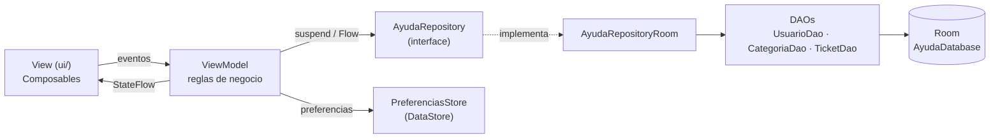
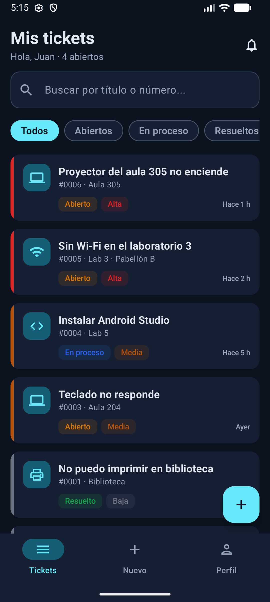
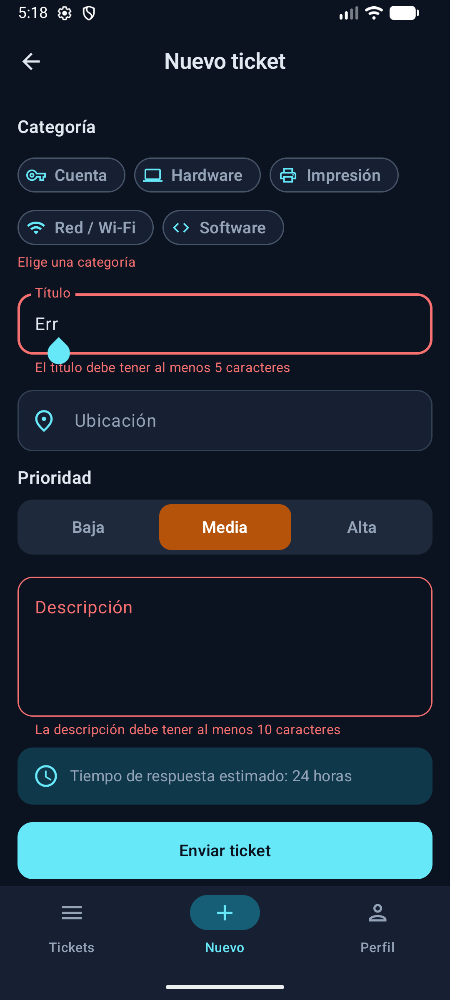
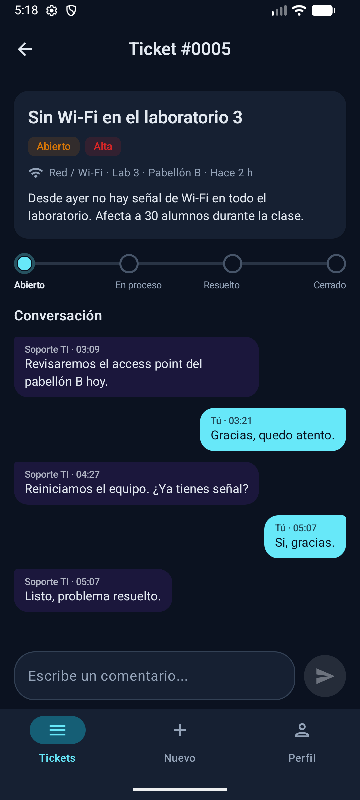
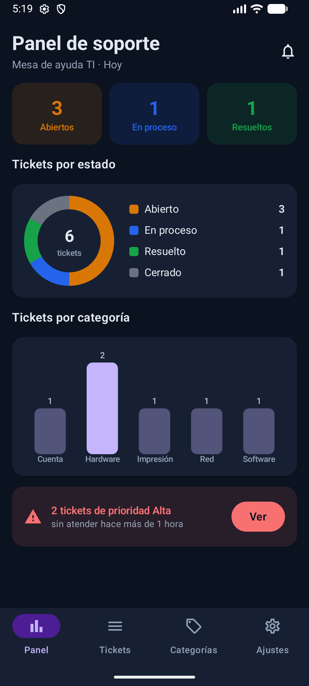
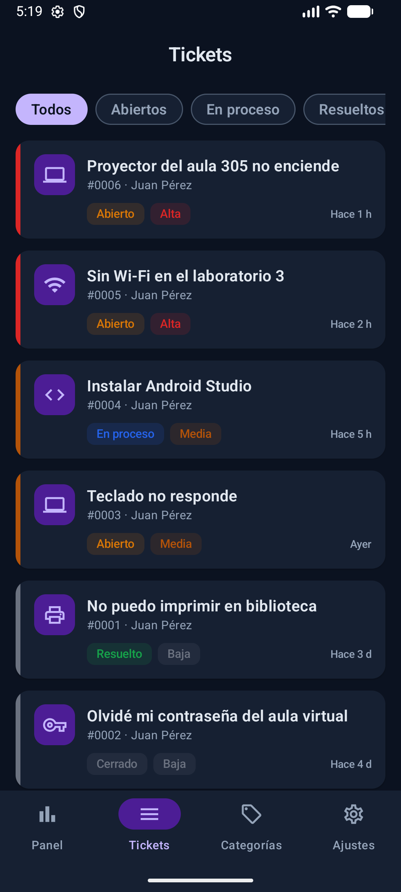
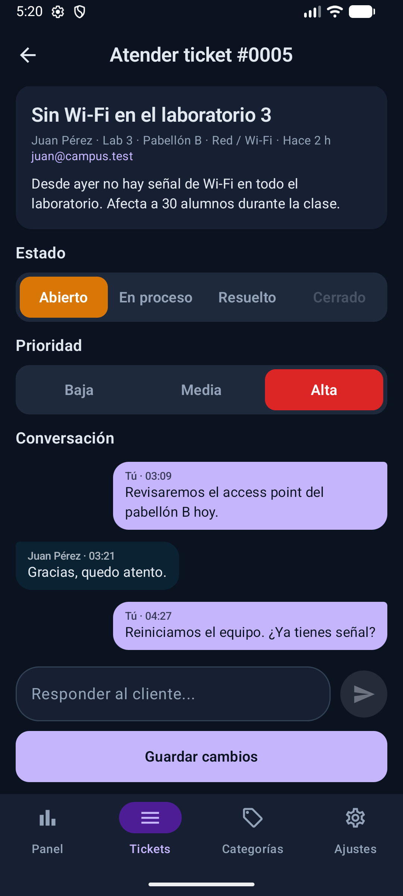

# AyudaCampus · Mesa de ayuda TI del campus

App Android hecha con **Kotlin + Jetpack Compose + Material 3** (sin XML), **Room 2.6.1**, **DataStore** y **Navigation Compose**. Sigue el patrón **MVVM + Repository (interface)**.

Tiene dos perfiles en el mismo dispositivo, y ambos usan la misma base de datos Room:

- **Estudiante** (cian `#0891B2`): reporta una incidencia, conversa con Soporte, califica la atención y cierra o reabre el ticket.
- **Soporte TI** (violeta `#7C3AED`): ve el panel con gráficos, atiende los tickets (estado, prioridad y respuesta) y administra las categorías.

Cuando Soporte responde o cambia el estado de un ticket, el estudiante lo ve al instante en el detalle, porque la pantalla lee los datos con `Flow`.

> Laboratorio 08 · MVVM + Room · Programación en Móviles · Autor: Farid Chávez (faridchz16)

## Cuentas de prueba

| Perfil | Correo | Contraseña |
|---|---|---|
| Estudiante | `juan@campus.test` | `1234` |
| Soporte TI | `soporte@campus.test` | `admin` |

La primera vez que se abre la app se cargan 5 categorías, estos 2 usuarios y 6 tickets de ejemplo en distintos estados, con 4 comentarios.

## Cómo ejecutar

1. Abre la carpeta `Semana08/AyudaCampus` en Android Studio y espera a que termine el *Sync* de Gradle.
2. Ejecuta la app en un emulador o en un dispositivo con API 26 o superior.

## Arquitectura MVVM



```
View (ui/)  ──eventos──▶  ViewModel  ──suspend/Flow──▶  AyudaRepository (interface)
    ▲                       │                                  │
    └──── StateFlow ────────┘                         AyudaRepositoryRoom
                                                               │
                                                     DAOs (SQL) ──▶ Room (4 tablas)
```

| Capa | Conoce a | No debe |
|---|---|---|
| View (`ui/`) | Solo a su ViewModel | Usar DAO, Repository ni reglas de negocio |
| ViewModel | Solo al Repository (interface) | Conocer Composables ni el DAO |
| Repository | Los DAOs (en la implementación) | Conocer pantallas ni ViewModels |
| DAO / Room | SQL y entidades | Conocer ViewModels |

**Regla de oro:** si una lectura debe actualizar la pantalla, usa `Flow` (sin `suspend`). Si es una escritura o una acción única, usa `suspend`.

## Base de datos (4 tablas)

| Tabla | Relación |
|---|---|
| `usuarios` (rol: CLIENTE \| ADMIN) | — |
| `categorias` (icono: pc, code, wifi, key, printer, tag) | — |
| `tickets` (prioridad BAJA/MEDIA/ALTA · estado ABIERTO/EN_PROCESO/RESUELTO/CERRADO) | N tickets → 1 cliente; N tickets → 1 categoría |
| `comentarios` | N comentarios → 1 ticket (`onDelete = CASCADE`) |

`TicketConDetalle` junta en un solo objeto el ticket (`@Embedded`), sus comentarios, su categoría y su cliente (cada uno con `@Relation`). Para el panel, la consulta usa `LEFT JOIN` y `COUNT`.

## Árbol de paquetes

```
com.faridchavez.ayudacampus
├── MainActivity.kt
├── AyudaApp.kt                    crea la base, el repositorio y las preferencias
├── data
│   ├── local
│   │   ├── AyudaDatabase.kt       singleton con las 4 entidades
│   │   ├── DatosIniciales.kt      datos de prueba (solo la primera vez)
│   │   ├── entity                 Usuario · Categoria · Ticket · Comentario
│   │   ├── dao                    UsuarioDao · CategoriaDao · TicketDao
│   │   └── relation               TicketConDetalle
│   ├── repository                 AyudaRepository (interface) · AyudaRepositoryRoom
│   └── prefs                      PreferenciasStore (DataStore)
├── model                          Rol · EstadoTicket · Prioridad · ConteoCategoria
├── viewmodel
│   ├── AyudaViewModelFactory.kt
│   ├── SesionViewModel.kt         login, sesión, preferencias, cambio de perfil
│   ├── MisTicketsViewModel.kt     combine(tickets, filtro, búsqueda)
│   ├── NuevoTicketViewModel.kt    validaciones del formulario
│   ├── TicketDetalleViewModel.kt  comentar, cerrar con calificación, reabrir
│   ├── PanelViewModel.kt          contadores, gráficos y alerta
│   ├── BandejaViewModel.kt        filtro que conserva el orden por prioridad
│   ├── AtenderViewModel.kt        reglas de estado de Soporte
│   └── CategoriasViewModel.kt     lista, guardar y eliminar
└── ui
    ├── theme                      Color · Type · Theme (AyudaTheme(rol, oscuro))
    ├── components                 AppTopBar · AyudaButton · AyudaTextField · EstadoChip
    │   │                          PrioridadChip · TicketCard · BurbujaComentario
    │   │                          StepperTicket · Estrellas · SelectorOpciones
    │   │                          CampoComentario · EstadoVacio · ComponentesPerfil
    │   └── graficos               GraficoDona · GraficoBarras · DatoGrafico
    ├── navigation                 Rutas · NavAyuda (grafos cliente y soporte)
    ├── cliente                    Splash · Login · MisTickets · NuevoTicket
    │                              DetalleTicket · Perfil
    └── soporte                    Panel · Bandeja · AtenderTicket · Categorias
                                   FormularioCategoria · Ajustes
```

## Reglas de negocio (en los ViewModels)

- **Visibilidad:** el estudiante solo ve sus tickets; Soporte ve todos.
- **Crear un ticket:** el título debe tener al menos 5 caracteres y la descripción al menos 10. Hay que elegir una categoría activa. La prioridad por defecto es MEDIA y el estado inicial es ABIERTO.
- **Soporte:** puede poner un ticket en ABIERTO, EN_PROCESO o RESUELTO y cambiar su prioridad. La opción CERRADO aparece deshabilitada, y un ticket cerrado ya no se puede modificar.
- **Cerrar (estudiante):** solo si el ticket está RESUELTO y tiene una calificación de 1 a 5. Al cerrar se guarda `fechaCierre`.
- **Reabrir (estudiante):** solo si el ticket está RESUELTO. Vuelve a ABIERTO y se borran la calificación y la fecha de cierre.
- **Comentarios:** ambos perfiles pueden comentar mientras el ticket no esté CERRADO. El texto no puede estar vacío.
- **Bandeja:** primero ALTA, luego MEDIA y BAJA; dentro de cada prioridad, el más reciente primero. El orden se hace en SQL con `CASE`.
- **Alerta del panel:** cuenta los tickets ALTA en estado ABIERTO con más de 1 hora de antigüedad.
- **Recibir tickets:** si Soporte lo apaga, el estudiante ve el aviso "Mesa de ayuda cerrada" y no puede crear tickets.

## Capturas

| Estudiante | | |
|---|---|---|
|  |  |  |
| **Soporte TI** | | |
|  |  |  |

## Pruebas de aceptación

| Prueba | Resultado esperado | OK |
|---|---|---|
| Login con clave incorrecta | Mensaje de error, no entra | ✅ |
| Estudiante: crear ticket vacío | Errores junto a cada campo, no se crea | ✅ |
| Estudiante: crear ticket válido | Aparece en Mis tickets como ABIERTO con la prioridad elegida | ✅ |
| Soporte: bandeja | El ticket nuevo aparece; los de prioridad Alta salen primero | ✅ |
| Soporte: pasar a En proceso y responder | El estudiante ve el nuevo estado y la respuesta sin reiniciar | ✅ |
| Soporte: intentar cerrar un ticket | La opción Cerrado está deshabilitada | ✅ |
| Soporte: marcar Resuelto | El estudiante ve el aviso verde, califica con 4 estrellas y cierra | ✅ |
| Estudiante: reabrir un ticket resuelto | Vuelve a Abierto y se borra la calificación | ✅ |
| Comentar en un ticket cerrado | El campo no aparece | ✅ |
| Panel | Contadores y gráficos coinciden con la bandeja; la alerta cuenta las ALTA abiertas con más de 1 hora | ✅ |
| Desactivar una categoría | Ya no se puede elegir al crear un ticket | ✅ |
| Cerrar y abrir la app | Los tickets siguen ahí y se recuerdan el perfil y el modo oscuro | ✅ |

## Para pensar

| Pregunta | Respuesta |
|---|---|
| ¿Por qué las reglas de estado están en el ViewModel y no en el DAO ni en el Composable? | Porque son lógica de negocio: el DAO solo guarda y lee datos, y el Composable solo dibuja. En el ViewModel se pueden probar y reutilizar sin depender de la UI ni de Room. |
| ¿Por qué `crearTicket` es `suspend` y `observarTicket` es `Flow`? | Crear es una acción única que termina; observar es una lectura que debe seguir emitiendo cada vez que la tabla cambia. |
| ¿Qué pasaría si un ticket pudiera cerrarse sin calificación? | Perderíamos la medición de la calidad de la atención y Soporte podría cerrar tickets sin que el estudiante confirme que se resolvió. |
| ¿Qué debería cambiar si mañana los tickets viven en un servidor? | Solo una nueva implementación de `AyudaRepository` (por ejemplo, con Retrofit). Los ViewModels y las pantallas no cambian, porque dependen de la interface. |